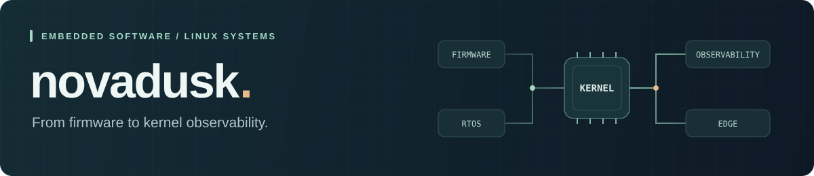

  

  <b>Embedded Software &amp; Linux Systems</b> 
  FreeRTOS · Linux kernel observability · Industrial edge platforms

## Selected projects

<table>
  <tr>
    <td width="50%" valign="top">
      <h3>01 &nbsp; <a href="https://github.com/novadusk/MemScope-Guard">MemScope Guard ↗</a></h3>
      
Linux memory pressure and fragmentation diagnostics, with an emphasis on runtime evidence.

      
<code>Linux</code> <code>eBPF</code> <code>Python</code>

    </td>
    <td width="50%" valign="top">
      <h3>02 &nbsp; <a href="https://github.com/novadusk/stm32-freertos-range-hood-controller">FreeRTOS Controller ↗</a></h3>
      
STM32F103 controller combining sensor acquisition, PID motor control, UART/DMA and IAP.

      
<code>STM32</code> <code>FreeRTOS</code> <code>C</code>

    </td>
  </tr>
  <tr>
    <td width="50%" valign="top">
      <h3>03 &nbsp; <a href="https://github.com/novadusk/linux-physical-memory-fragmentation-detector">Memory Fragmentation ↗</a></h3>
      
eBPF tools for observing Linux physical memory fragmentation and buddy allocator behavior.

      
<code>Linux memory</code> <code>BCC</code> <code>Python</code>

    </td>
    <td width="50%" valign="top">
      <h3>04 &nbsp; <a href="https://github.com/novadusk/mine-inspection-platform-mimo">Edge Inspection Platform ↗</a></h3>
      
Multi-modal inspection robotics bringing together edge perception, station dispatch and verification workflows.

      
<code>Edge perception</code> <code>Robotics</code> <code>C++</code>

    </td>
  </tr>
</table>

Project titles link to private source repositories. Sign in with an authorized account to access them.

## Engineering toolkit

| Focus | Technologies |
| :--- | :--- |
| **Firmware & control** | STM32 · ARM Cortex-M · FreeRTOS · PID · UART/DMA · IAP |
| **Linux & observability** | Linux kernel · Memory subsystem · eBPF · BCC / bpftrace |
| **Languages** | C · C++ · Python · Shell · ARM assembly |
| **Build & debug** | GCC / Clang · CMake · Make · GDB · OpenOCD · Git |

## Open source

A selection of pull requests to upstream projects:

| Project | Contribution |
| :--- | :--- |
| **Rockchip MPP** | [Release camera resources on initialization failure](https://github.com/rockchip-linux/mpp/pull/975) |
| **Armbian** | [Accept `.dtso` sources in the overlay utility](https://github.com/armbian/build/pull/10963) |
| **RKNN Model Zoo** | [Free preprocessing buffers on inference errors](https://github.com/airockchip/rknn_model_zoo/pull/455) |

  <a href="https://github.com/pulls?q=is%3Apr+author%3Anovadusk+is%3Apublic+-user%3Anovadusk">More upstream contributions ↗</a>

